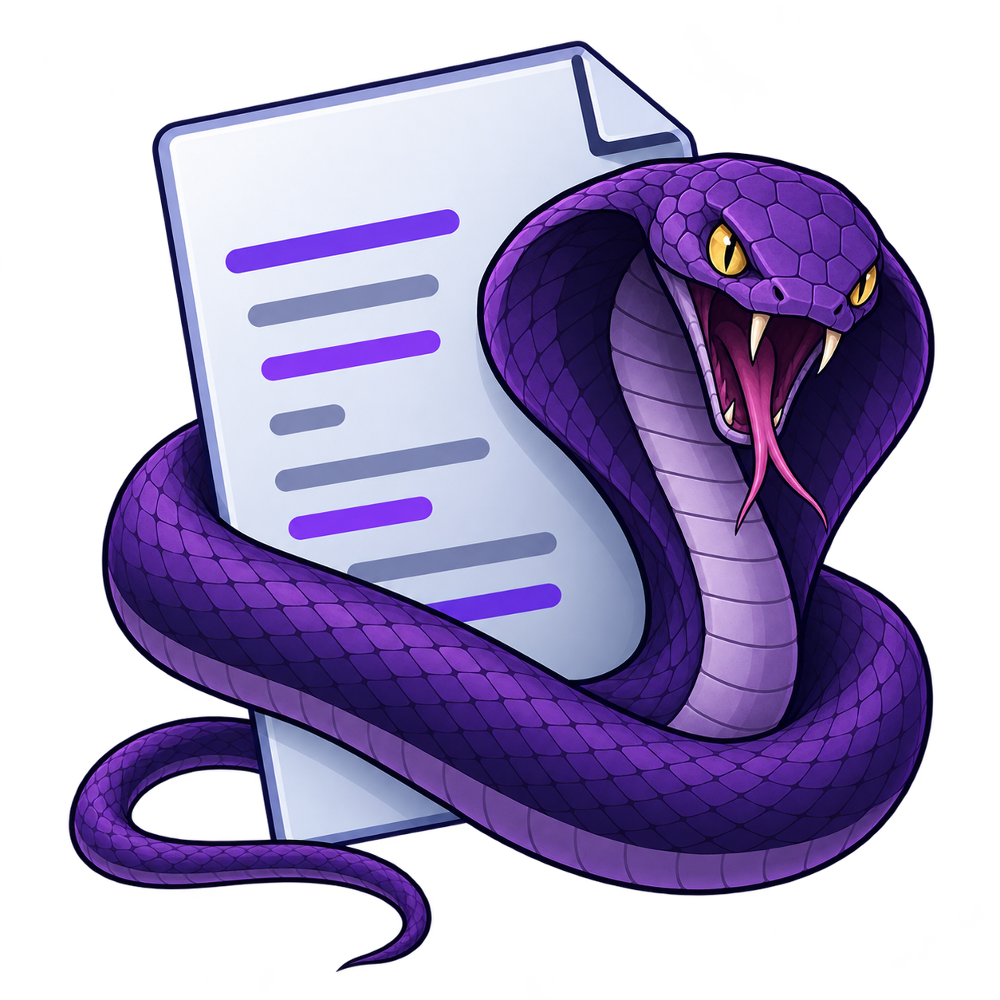

<p align="center"></p>

# quin

> [!WARNING]
> Although this text editor targets fully manual (artisanal) coding, it is COMPLETELY vibe-coded with only some sprinkles of human-made tweaks. 
> I do intend to rewrite parts of it by hand, but this will forever be an AI-centric codebase due to 2 reasons:
> 
> 1. I really wanted a code editor thats plug and play for my necessities without actually requiring to tweak keybindings, plugins, etc; and
> 2. I have many more projects that are more interesting to me than a text editor.
> 
> Feel free to open PRs or code suggestions though!

A small, fast, keyboard-driven code editor with a native GUI. No LSP, no AI,
no plugins: text, syntax highlighting, splits, tabs, fuzzy pickers and a real
terminal in a buffer. Helix-style modal editing, trimmed to the basics.

- **Native and light.** Rust, software rendering (`winit` + `softbuffer`),
  nine direct dependencies, a ~12 MB binary, no GPU needed. Runs on Linux
  (Wayland/X11), macOS and Windows. Iosevka and the Nerd Font symbols are
  embedded, ligatures included, so it looks the same everywhere.
- **Buffers and frames.** Buffers are files, scratch pads or terminals. Frames
  split the window (side by side or stacked); tabs hold layouts. Everything is
  driven from the keyboard.
- **Own syntax format.** Highlighting rules live in small readable `*.syn`
  files which also say *how* tokens render: Markdown headings are bigger,
  `**markers**` are hidden, list bullets become `•`, fenced code is highlighted
  in its own language, tables line up in a grid, `> [!NOTE]` callouts get a
  coloured bar, and images and inline HTML show as they would on a forge.
  Converters import TextMate grammars and tree-sitter `highlights.scm` files.
- **Fuzzy everything.** File picker (any directory on the machine), buffer
  picker, command palette, and a global search that fills in as you type.

`AGENTS.md` lists the goals and constraints the project is built under.

## Build and run

```sh
cargo build --release
./target/release/quin                 # scratch buffer, cwd = current directory
./target/release/quin src/main.rs     # open a file
./target/release/quin ~/project       # a directory sets the working directory
./target/release/quin a.rs b.rs       # several files (buffers)
```

`./target/release/quin install` copies the binary to `~/.local/bin` and, on
Linux, adds a desktop entry and icon under `~/.local/share` so launchers show
it. Run it again after rebuilding: it replaces the previous binary, entry and
icon (some launchers keep showing the old icon until the next login). Paths in `:cd`, `:open` and
`:write` understand `~`.

Linux needs the usual `libxkbcommon` / Wayland or X11 client libraries at run
time (they are loaded dynamically). The system clipboard uses `wl-copy`,
`xclip`, `xsel`, `pbcopy` or `clip`, whichever exists; without them an
in-process clipboard is used.

Everything is also reachable without a window: `quin --screenshot out.ppm
--keys "space e" file.rs` renders one frame to an image, which is how the UI is
tested (`wait` in the key list lets a shell or a search finish).

## Using it

quin is modal, like Helix (and Kakoune): **selection first, then action**.
Every cursor is a one-character selection; motions extend or replace the
selection and `d`, `c`, `y` act on it. Yank, delete and paste always go
through the system clipboard; there are no registers. `p` and `P` paste like
vim: after or before the selection in normal mode (whole lines go below or
above), replacing the selection in select mode.

| Mode | How to get there | What keys do |
|---|---|---|
| **NOR** normal | `esc` | motions, selections, commands |
| **INS** insert | `i a I A o O c` | type text; `esc` returns to normal |
| **REP** replace | `R` | like insert, but typing overwrites |
| **SEL** select | `v` | like normal, but motions extend the selection |
| **TRM** terminal | `:terminal`, or `i` on a terminal buffer | keys go to the shell; `C-esc` for normal mode |

**`:help` is the reference.** It lists every key and command, grouped by
mode and by special buffer (tree, git, terminal), straight from the key
tables in `src/keymap.rs`; opened from one of those buffers it lands on the
matching section. This file only gives the shape of things.

`:` opens the **command palette**: start typing to fuzzy-filter commands,
`ret` runs the highlighted one, `tab` completes its name. Commands with
arguments are typed in full (`:write notes.md`, `:cd ~/src`); while the
argument of `cd`, `open` or `write` is typed, the list shows the entries of
the directory typed so far. Typing a number (`:42`) jumps to that line.

The pieces, each of them an ordinary buffer:

- **Pickers.** `space e` opens a file below the working directory (honouring
  `.gitignore`), `space E` everything, `space b` an open buffer, `space f`
  searches every file as you type (seeded with the last `*` or `/` pattern).
  Typing a path that starts with `/`, `~/`, `./` or `../` into the file picker
  browses that directory instead, so nothing ties you to one project. Each
  picker previews the highlighted item on the right; `C-S-v` pastes the
  clipboard into any of them.
- **Frames and tabs.** `space w` splits, closes, focuses, swaps, resizes
  (`+ - < >`, repeatable) and equalises (`0`) frames, and opens or closes tabs;
  `gt` / `gT` switch tabs. A tab bar shows only with more than one tab.
- **Terminal.** `:terminal` runs your shell in the current frame. Keys go to
  the shell; `C-esc` drops to normal mode over the screen and scrollback,
  where every read-only key works and `p` types the clipboard. Applications
  that ask for the mouse get it; a plain shell scrolls with the wheel and
  selects on drag. When the shell exits the frame closes.
- **File tree.** `A-e` or `:tree` toggles a sidebar in the spirit of oil.nvim:
  `ret` opens a file or folds a directory, `S-ret` changes the working
  directory, `-` shows the parent, `.` shows or hides dot-files, and editing
  the text then `:write` renames, creates (a trailing `/` makes a directory),
  moves and deletes entries; deletes need a second `:write`. Git colours
  changed and new files and marks directories with changes inside.
- **Git.** The status line shows the branch (`*` when dirty) and `N↑ M↓`
  when there is something to push or pull, kept fresh in the background.
  `space l` opens a status buffer in its own tab: `ret` opens a file in a
  read-only preview coloured against HEAD, `tab` unfolds its diff, `s` stages
  or unstages a file, a hunk or a whole section, `c c` / `c a` commit or
  amend through a floating message (`:write` commits, `:quit` cancels),
  `p` / `P` pull and push, and `space l` again refreshes the status. In
  every file, a mark on the left edge of the frame shows the lines changed
  since HEAD, unsaved edits included: green for added, yellow for modified,
  and a red wedge where lines were deleted. Nothing git-related ever blocks
  the editor.
- **Welcome page.** Started without a file, quin shows the logo and the ten
  most recent entries: directories moved into with `:cd` and files opened by
  name. `ret` opens one; starting to type swaps the page for a scratch buffer.
  The page does not scroll.

Long lines scroll sideways unless `:wrap` is on (or `wrap = true` in the
config), which folds them at the frame edge, breaking at spaces. Scroll jumps
and the cursor slide to their targets (`scroll-animation`,
`cursor-animation`). The mouse places the cursor, drags selections, scrolls
and switches tabs. Closing the window with unsaved changes asks a second time.

## Configuration

`:config` opens the configuration file, creating it with the current font
size, font family and theme. It lives in the OS configuration directory:

| OS | File |
|---|---|
| Linux, BSD | `~/.config/quin/config.toml` (`$XDG_CONFIG_HOME` honoured) |
| macOS | `~/Library/Application Support/quin/config.toml` |
| Windows | `%APPDATA%\quin\config.toml` |

`QUIN_CONFIG_DIR` overrides the directory. The file is flat TOML, one
`key = value` per line:

```toml
font-size    = 14
font-family  = "JetBrainsMono Nerd Font"  # optional; the default is the embedded Iosevka
font         = "~/fonts/mono.ttf"    # a font file instead of a family; bold-font too
ligatures    = true
theme        = "dark"                # dark, light, a bundled scheme, or a file in themes/
tab-width    = 4
line-numbers = "on"                  # "on", "off", "relative"
cursorline   = true
scrolloff    = 3
auto-pairs   = true
wrap         = false                 # soft-wrap long lines; `:wrap` toggles it for the session
scroll-animation = 120               # milliseconds a scroll jump slides; 0 jumps at once
cursor-animation = 80                # milliseconds the cursor slides; 0 jumps at once
shell        = "/bin/zsh"
```

**Themes.** `dark` and `light` are quin's own. The other 800-odd names in
`:theme` are the [iTerm2-Color-Schemes](https://github.com/mbadolato/iTerm2-Color-Schemes)
collection that Ghostty ships (`catppuccin-mocha`, `gruvbox-dark`,
`solarized-light`...): each 16-color terminal palette is turned into a full
editor theme, and terminals inside quin use that palette as is.

**Fonts.** Iosevka (the Nerd Font Mono build in regular, bold, italic and
bold italic, subset to Latin, Greek, Cyrillic, punctuation, box drawing and
Powerline) is embedded, so the editor looks the same wherever it is
installed. A `font-family` picks up its bold and italic files when they sit
next to the regular one; a font without them gets bold by smearing and
italic by a smooth slant. `font-family` names
any installed font by its family name, matched against the font file names
without spaces or case (`"JetBrainsMono Nerd Font"`); `font` points at a
font file. The Nerd Font symbol set is embedded as a fallback for every
font, so prompt and file icons always render. Ligatures (`->`, `!=`, `::`...) come from the font's own rules
(`ligatures off` disables them).

The same directory can hold:

- `syntax/*.syn` — extra languages (a file with the same `name` as a built-in
  replaces it);
- `themes/*.theme` — extra themes (`scope #rrggbb [bold] [italic]`, see
  `assets/themes/dark.theme` for every scope).

## Syntax files

Languages are described in `assets/syntax/*.syn` (built into the binary) with
a tiny line-oriented format. Arguments are separated by spaces; quote with
`'...'` or `"..."` when a regex contains spaces (no escapes inside quotes).

```
name          rust
extensions    rs
line-comment  //
block-comment /* */
indent        4 spaces
auto-pairs    () [] {} "" ``

keywords keyword.control  if else match loop while for in break continue return
keywords type.builtin     bool char str u8 u16 u32 String Vec Option Result

match comment          //.*
match string           "(?:[^"\\]|\\.)*"
  match string.escape  \\.                      # indented: applies inside the rule above
match function         \b([A-Za-z_]\w*)\s*\(   1:function   # capture 1 gets its own scope
match number           \b\d[\d_]*\b

region comment         /\*  \*/                 # multi-line, may span lines
region code.block      '^```\s*(\w*)'  '^```'  embed=1   # embed the language named by capture 1
region quote           '^>'  '^[^>]'  keep-end          # ends before the first line without `>`

style comment.todo bold
```

Rules are tried in order at each position; the earliest match wins (first
rule on ties). Regexes use Rust's `regex` syntax: no look-around, no
back-references. `^`/`$` are line boundaries. A region's end may be `$`, which
makes a one-line region that can hold inner rules. With `keep-end`, the region
closes where its end matches, but the matched text is not part of it: the
rules outside the region highlight that text again.

**Rendering** is where the format differs from classic highlighters.
`style <scope> ...` attaches display attributes to a scope:

| Attribute | Effect |
|---|---|
| `bold` `italic` `underline` `strike` | text style |
| `size=1.5` | bigger text (headings) |
| `conceal` | hidden unless the cursor is on the line |
| `replace=•` | draw this text instead of the token |
| `bg=<scope>` | background from the theme color of another scope |
| `bar=<scope>` | on a region: a bar in that color on the left of each of its lines |
| `center` | on a region: its lines are centered in the frame |
| `grid` | on a region: its lines are rows of a `\|` table, aligned into columns with borders |
| `image` | the token names an image file, drawn below the line |

See `assets/syntax/markdown.syn`: `# Heading` hides the `#` and draws the text
at 1.6x bold, `**bold**` hides the stars, `- item` becomes `• item`, `[text](url)`
shows only the underlined text, and fenced code blocks embed the named
language. Put the cursor on a line to see it as written.

Markdown also renders these blocks:

- **Tables.** Each row is a one-line `grid` region. The columns get the width
  of their widest cell (the editor looks up to 100 rows above and below the
  screen). The `|---|` row sets the alignment (`:--`, `:-:`, `--:`), and the
  rows above it are the bold header. The row under the cursor shows as
  written.
- **Callouts.** `> [!NOTE]`, `[!TIP]`, `[!IMPORTANT]`, `[!WARNING]` and
  `[!CAUTION]` (also `[!INFO]`, `[!DANGER]`...) start a quote with a coloured
  bar, a tint, an icon and a title. Plain `>` quotes get a grey bar. Themes
  set the colours with `callout.<kind>` and `callout.<kind>.background`.
- **Images.** ``, `[](link)` and `` show the image below the line, scaled to fit the frame. A line
  that holds only images shows only the images. Paths are relative to the
  Markdown file. Files load on a background thread; until then, and for images
  that cannot load, the alt text (or the tag) stays.
- **Inline HTML.** Tags are hidden. `<b>`, `<i>`, `<u>`, `<s>`, `<code>`,
  `<kbd>`, `<h1>`-`<h3>` and `<summary>` style their content, `align="center"`
  on `<p>`, `<div>` or `<h1>`-`<h6>` centers the block, and common entities
  (`&nbsp;`, `&amp;`, `&copy;`, `&mdash;`...) show as their character.

Scope names are shared with the themes (`keyword`, `string`, `comment`,
`function`, `type`, `number`, `heading.1`, `strong`, `link`...). A theme line
is `scope #rrggbb [bold] [italic] [underline]`; dotted scopes fall back to
their parent (`heading.3` → `heading`). `assets/themes/dark.theme` lists every
UI and syntax scope.

Built-in languages: Rust, Markdown, C, C++, Python, JavaScript, TypeScript, Go,
shell, TOML, JSON, YAML, HTML (with CSS/JS embedded), CSS, Lua, Zig, Java, C#,
Ruby, SQL, Makefile, diff, git commit, INI, XML, Haskell, OCaml, Elixir,
Kotlin, Swift, PHP, Nix, Dockerfile, CMake, LaTeX, and quin's own files.

### Importing grammars

```sh
quin convert textmate grammar.tmLanguage.json my-lang.syn
quin convert treesitter mylang highlights.scm my-lang.syn
```

TextMate grammars (what VS Code uses) convert rule by rule; Oniguruma-only
constructs are rewritten when possible and otherwise skipped with a `#
skipped: ...` comment in the output. tree-sitter grammars are real parsers and
cannot be converted faithfully: the converter extracts the keyword lists and
node hints from `highlights.scm` and adds generic rules, giving a starting
point to edit by hand. Drop the result in `~/.config/quin/syntax/`.


## Limitations and ideas

- One font family plus the symbol fallback. Characters the font lacks show
  as `�` (CJK needs a font that has them: set `font` in the config). Fonts
  are found by file name, not through fontconfig.
- Terminal: no images (sixel and the like).
- Markdown images: local PNG files only (not interlaced). No JPEG, GIF or SVG,
  and no remote URLs (badges show their alt text). Table rows do not wrap.
- No LSP, no tree-sitter, and that is on purpose.
- A WebAssembly build is not wired up yet; the platform-specific parts
  (terminal, clipboard, file system) are confined to a few files for when it is.
